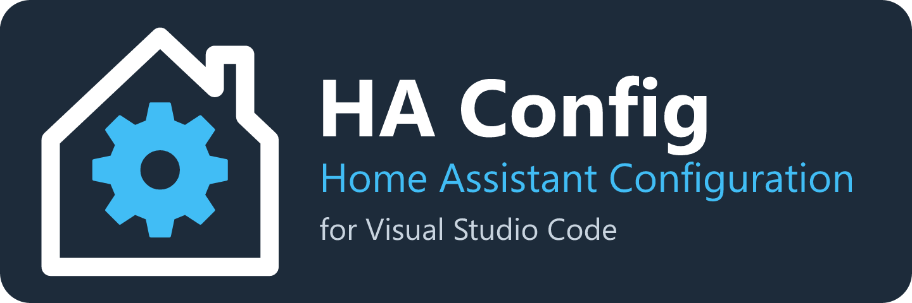

<h1 align="center">

</h1>

# Getting started

1. Install via the [VS Code Marketplace](https://marketplace.visualstudio.com/items?itemName=blown.vscode-ha-config)

2. Open your (local copy of the) Home Assistant Configuration with VS Code

3. Configure the connection to Home Assistant via the HA Section in the VS Code Settings UI

   More details in [the How-To in the Wiki](https://github.com/keesschollaart81/vscode-home-assistant/wiki/Configure-connection-to-HA)

4. Enjoy the features showcased below 👇

5. Continue reading in the Wiki:

   - [Configure connection to HA](https://github.com/keesschollaart81/vscode-home-assistant/wiki/Configure-connection-to-HA)
   - [VS Code Remote SSH](https://github.com/keesschollaart81/vscode-home-assistant/wiki/VS-Code-Remote-SSH)
   - [Your config, local or remote?](https://github.com/keesschollaart81/vscode-home-assistant/wiki/Your-config,-local-or-remote%3F)
   - [The troubleshooting guide](https://github.com/keesschollaart81/vscode-home-assistant/wiki/Troubleshooting)

# Features

## Completion for Entity IDs, Actions, Scenes and Triggers

When connected with your Home Assistant server, entity IDs and actions will be auto-completed.

## Completion & Validation for Configuration & Lovelace Schema

Most of the scheme's of Home Assistant will be validated and things like properties, values and enums will be auto-completed. This extension understands the behaviour of Home Assistant '!include...' behaviour and use this to provide scoped validation for all your files.

Deprecation Warnings:

Schema Documentation

## Go to Definition for Includes

Easy navigate between your files references via the different !include... tags using 'f12' / 'Go to Definition'.

## Snippets

Snippets allow you to create commonly used data structures very quickly.

## Commands

Commands allow you to quickly interact with Home Assistant! Find them using Cmd+shift+P and type 'Home Assistant'

## Render templates

Evaluate jinja templates via Home Assistant's API and see how they would render.

# Contribution

- [How to update the schemas](https://github.com/keesschollaart81/vscode-home-assistant/wiki/HowTo:-Update-the-schema's)
- [Local Development](https://github.com/keesschollaart81/vscode-home-assistant/wiki/Local-development-of-this-Extension)

# Release Notes

Read all the recent changes in the [GitHub releases section](https://github.com/jlusky/vscode-ha-config/releases)

# Feedback / Ideas

Create an [issue](https://github.com/jlusky/vscode-ha-config/issues/new/choose), reach out to me on [Twitter](https://twitter.com/keesschollaart) or the [Home Assistant Discord](https://discord.gg/c5DvZ4e).

# Things to do / up for grabs

- [ ] Go to Definition for entities, scripts and automations
- [ ] Check local config with HA Server

# Telemetry

The extension sends telemetry to an Azure Application Insights resource owned by
this extension's publisher, using
[@vscode/extension-telemetry](https://github.com/microsoft/vscode-extension-telemetry).
It sends:

- **Activation:** one `extension.activate` event each time the extension starts.
- **Errors:** VS Code reports errors that the extension doesn't handle, with the
  error message and stack trace.

The library adds its
[common properties](https://github.com/microsoft/vscode-extension-telemetry#common-properties)
to every event:

- Extension name and version
- VS Code version, product, UI kind and commit
- VS Code's machine ID and session ID, and whether it's a new install
- Operating system, platform version and architecture
- Remote connection type, such as SSH or WSL

The extension doesn't send your configuration or entity names, or anything about
your Home Assistant instance. An error message could include details of what
failed, such as a file name.

Telemetry follows VS Code's `telemetry.telemetryLevel` setting: set it to `off`
and the extension sends nothing, or to `error` to send only error reports. See VS Code's
[telemetry documentation](https://code.visualstudio.com/docs/configure/telemetry)
for details.
